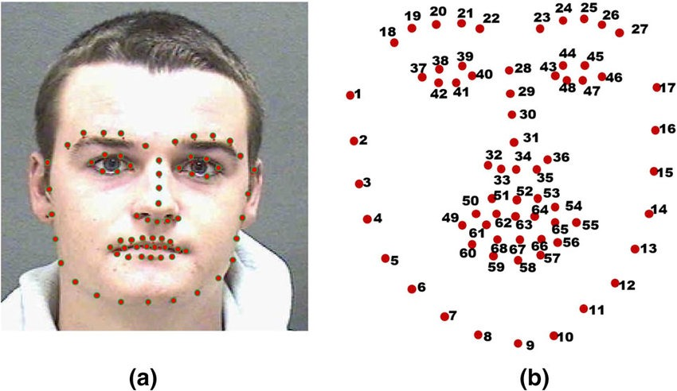

# MiraComix

Turn a chat into a 4-panel comic starring the people in it. Send the conversation as text or a screenshot, add profile photos, and watch the panels draw themselves, on the web or in Telegram.

```
 web form / Telegram bot
          |
          v
 Flask app ── POST /api/comics ──> job queue (ThreadPoolExecutor)
          |                                |
          |           1. Gemini: one character sheet per person (reads their photo)
          |           2. Gemini: 4-panel script (scenes + dialogue) as JSON
          |           3. FLUX: 4 panels rendered in parallel (Cloudflare or Pollinations)
          |           4. Pillow: dialogue strip per panel, 2x2 comic page
          |                                |
          <── SSE /api/comics/<id>/events ─┘  (web: panels appear as they finish)
              Telegram: each panel is sent as it finishes, then the page + share link
```

## How it works

| Step | Code | Notes |
| --- | --- | --- |
| Character sheets | `miracomix/llm.py` `describe_character` | Gemini Flash, structured JSON output (Pydantic schema). Photos are re-encoded to JPEG first. |
| Script | `llm.write_script` | Exactly 4 panels; each scene is a standalone image prompt that repeats every character's appearance, so they look the same across panels. |
| Panels | `miracomix/images.py` | FLUX.1 schnell on Cloudflare Workers AI or Pollinations, chosen per comic. One seed per comic on Pollinations (Cloudflare's FLUX accepts no seed). Retries 429/5xx with backoff. |
| Dialogue + page | `miracomix/render.py` | Dialogue is drawn with Pillow under each panel: diffusion models misspell text. |
| Jobs + state | `miracomix/pipeline.py`, `store.py` | Job threads coordinate; model calls run on a separate pool so a job waiting on its panels can't starve it. State lives in SQLite. |
| Web + API | `miracomix/__init__.py` | Flask: form, JSON API, server-sent events, share page with Open Graph image. |
| Telegram | `miracomix/telegram.py` | Webhook (secret-token checked) or long polling for local dev. One active comic per chat. |

## Run it

```bash
python3 -m venv .venv && .venv/bin/pip install -r requirements.txt
cp .env.example .env        # fill in the keys you have
.venv/bin/flask --app miracomix run
```

Open http://127.0.0.1:5000.

Keys (all have free tiers):

- `GEMINI_API_KEY`: [Google AI Studio](https://aistudio.google.com/apikey).
- Images, pick one or both (`IMAGE_PROVIDER` sets the default, the form can switch):
  - Cloudflare: `CLOUDFLARE_ACCOUNT_ID` + `CLOUDFLARE_API_TOKEN` with Workers AI permission.
  - Pollinations: `POLLINATIONS_KEY` from enter.pollinations.ai. Without a key it uses the free legacy endpoint, which may serve a different model than FLUX.
- Telegram (optional): `TELEGRAM_BOT_TOKEN` from @BotFather.

### Telegram

Local development, no public URL needed:

```bash
.venv/bin/flask --app miracomix telegram poll
```

Production: serve the app over HTTPS, set `TELEGRAM_WEBHOOK_SECRET` and `PUBLIC_URL`, then

```bash
.venv/bin/flask --app miracomix telegram set-webhook https://your.domain
```

Bots can't read private chats between two people, so the bot gets a conversation one of three ways:

- **Group:** add the bot to a group with the other person and chat as usual. `/comic` draws the last messages (up to 30), each speaker drawn from their profile photo. Turn privacy mode off first (@BotFather → `/setprivacy` → Disable), or the bot only sees commands; re-add the bot to the group after changing it.
- **Forwards:** forward messages from any chat to the bot, then send `/comic`. People who hide their account from forwards appear by name, without a photo.
- **Paste:** in a private chat with the bot, paste a conversation as text or send a screenshot. A photo with a name as its caption adds that person as a character.

`/reset` clears collected messages and added characters.

### Deploy on Render

1. Render dashboard → **New → Blueprint** → pick this repo. `render.yaml` defines the service.
2. Fill in the keys it asks for. `PUBLIC_URL` is the service URL (`https://<name>.onrender.com`); you can set it after the first deploy.
3. Point Telegram at it once, from your laptop, with the same token and secret in your local `.env`:
   `.venv/bin/flask --app miracomix telegram set-webhook https://<name>.onrender.com`

Free plan caveats: the service sleeps after 15 idle minutes and takes about a minute to wake (Telegram retries the webhook meanwhile), and its disk is wiped on every restart, so old share links stop working.

### Production notes

Run one process with threads, since the job queue lives in-process: `gunicorn -w 1 --threads 16 'miracomix:create_app()'`. To scale past one process, move jobs to a real queue (Redis + RQ/Celery) and files to object storage.

## Tests

```bash
.venv/bin/python -m pytest -q
```

Gemini, FLUX and the Telegram API are faked, so the suite runs offline.

## History

- **Jan 2025, prototype** (team project at Geek Gazette, IIT Roorkee): a Mira Flows compound flow (three chained LLM calls: one 31-attribute profile per character, then a comic prompt), dlib/DeepFace face analysis, OCR of chat screenshots, and a standalone FLUX test. The pieces were never wired together, and Mira's flow API has since gone offline.
- **Oct 2026, rebuild**: the same idea, end to end. Gemini replaces the Mira flow and the face-analysis stack, FLUX is wired in through hosted APIs, and there is a Flask app, a Telegram bot, live preview and share links.

The prototype's code is in the git history before the rebuild commit.

### Prototype outputs (2025)

| | | |
|---|---|---|
|  |  |  |

### Face landmarks (2025 prototype)

The prototype described each person from their photo with dlib's 68-point facial landmark model, then turned the points into attributes for the character prompt.



| Points (as numbered in the image) | Region | Attributes derived |
|---|---|---|
| 1-17 | Jaw line | jaw width, chin type, face shape |
| 18-27 | Eyebrows | eyebrow position and shape, forehead height |
| 28-36 | Nose | nose length and width |
| 37-48 | Eyes | eye distance, size and shape |
| 49-68 | Mouth | mouth width, lip fullness, teeth visible |

Examples of the measurements (dlib arrays are 0-based, so image point 1 is `landmarks[0]`):

- Face shape from ratios: jaw width `|p1 - p17|`, face height `|p9 - p28|`, cheekbone width `|p2 - p16|`. Height over 1.5x the jaw width means oval; cheekbones over 0.8x the height means round; jaw over 1.2x the cheekbones means square; otherwise heart-shaped.
- Eye spacing `|p37 - p46|`, nose length `|p28 - p34|`, mouth width `|p49 - p55|`.
- Teeth visible when the inner lips are apart: `|p63 - p67|` above a threshold.

**How it could be used in the current pipeline:** as an optional, deterministic step before Gemini. Measure the photo, pass the ratios into the character prompt ("narrow oval face, wide-set eyes"), and let Gemini write the description. That makes faces more consistent from photo to photo.

Two fixes the prototype needed:
- **Thresholds in raw pixels:** the prototype compared raw pixel distances against fixed thresholds (for example, "eye distance > 100 px means large eyes"), so the result depended on photo resolution. Divide every distance by the face width first.
- **Weight on the free plan:** dlib needs a C++ build and a ~100 MB model file, too heavy for Render's free plan (512 MB RAM). MediaPipe Face Mesh is a lighter option: 478 points, and it also runs in the browser.
